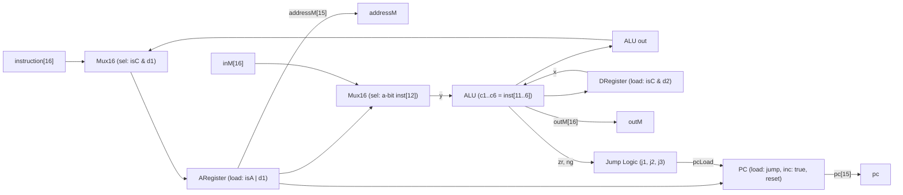

# Week 6: HackCPU 電路架構圖與控制邏輯解析

## 1. HackCPU 資料路徑與控制訊號圖

## 2. 指令解碼說明 (16-bit Instruction)
* **A-Instruction (`0vvvvvvvvvvvvvvv`)**: `instruction[15] = 0`，直接將 15-bit 常數載入 `ARegister`。
* **C-Instruction (`111accccccdddjjj`)**:
  * `a` (`instruction[12]`): 決定 ALU 的 Y 輸入來自 `ARegister` (`0`) 或 `inM` (`1`)。
  * `cccccc` (`instruction[11..6]`): 控制 ALU 的 `zx, nx, zy, ny, f, no` 運算旗標。
  * `ddd` (`instruction[5..3]`): 控制結果寫入目標 (`d1` -> A, `d2` -> D, `d3` -> `writeM`)。
  * `jjj` (`instruction[2..0]`): 搭配 ALU 狀態旗標 `zr` 與 `ng` 判斷是否觸發 `PC` 跳躍 (`pcLoad`)。